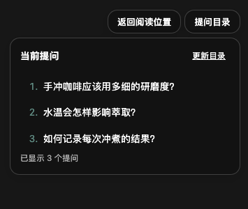

# ChatGPT 对话阅读面板

一个专注于长对话阅读的 Chrome 扩展。从提问目录跳回原文，看完点「返回阅读位置」，继续读刚才的段落。目录保存在当前 Chrome 配置中，再次打开同一对话可以直接使用。

## 安装与更新

1. 下载或克隆本仓库，把文件夹放在长期保留的位置。
2. 打开 Chrome 的 `chrome://extensions`，开启「开发者模式」，点「加载未打包的扩展程序」，选择直接包含 `manifest.json` 的文件夹。
3. 刷新已有的 ChatGPT 聊天页。使用旧版的人更新同一目录后，点扩展卡片上的圆形「重新加载」按钮，再刷新聊天页。1.3.0 新增本地存储权限。

## 怎么用

- 打开聊天，右侧会自动显示提问。再次访问时先显示本机保存的目录。点一条提问跳到原文，点「返回阅读位置」回到刚才的段落。
- 首次访问也可以边读边用。页面已经显示的提问会先出现。如果网页正常加载的对话数据包含完整的当前分支，目录会自动补齐。展开或收起目录都不会启动扫描。
- 如果网页只提供一部分消息，目录会随阅读逐步补充。想立即读完当前页面能展示的历史，可以点「更新目录」，扩展会滚动读取一次，并在结束后恢复位置。
- 侧栏平时沿用页面原色。悬停在某个标题上会显示页面提供的时间，并轻微放大该行和相邻行；启用系统「减少动态效果」时关闭缩放。

截图均来自运行扩展脚本的演示页面，使用虚构的标题和问题。

## 缓存和请求

目录按聊天 ID 存入 `chrome.storage.local`，包括提问文字、可用的消息 ID 和定位用的滚动位置。请把本地目录视作聊天内容的一份副本。卸载扩展可清除该扩展的本地缓存。

扩展只在 chatgpt.com 页面运行。它读取网页已发起的对话请求的响应副本，从当前分支提取用户问题。扩展本身不发对话请求，不调用模型，也没有定时刷新。自动显示和恢复目录都不会滚动正文。点击跳转或手动更新时，ChatGPT 自身可能为滚动到的位置加载历史消息。

## 虚拟滚动与验证边界

ChatGPT 会移除屏幕外的消息。遇到页面没有提供完整文本分支的情况，面板会显示「已显示 N 个提问」，并保存已读到的部分。手动更新最多运行两分钟，切换对话、隐藏页面或手动滚动可中断扫描。即使扫描到底，结果也只覆盖网页当时展示的分支。

- **隔离 Chromium，1.3.1**：在只有末尾三个提问出现在页面的样例中，进入后直接显示这三条。网页自己的对话请求返回后，目录补齐当前分支的 16 条提问。测试记录到一次网页请求、零次自动滚动。重访时，在正文出现前已从缓存显示 16 条，展开与收起没有增加请求。测试使用模拟对话响应和扩展存储。
- **真实 Chrome，1.2 系列**：一条长对话读出 16 个提问，抽测第 1、8、16 条跳转。一次返回测试回到了同一段落，位置偏差 0 像素。此结果覆盖当时的页面结构。
- **隔离 Chromium，1.3.0**：用三个演示提问验证首次自动建目录、保存一次、刷新后缓存命中、跳转和返回。测试使用模拟的扩展存储接口。缓存命中后打开目录，滚动调用和写入次数均为零。
- 网页结构、缩放、图片延迟加载及其他修改页面的扩展都可能影响定位。页面未提供创建或更新时间时，无法补全。

## 许可证

[MIT](LICENSE)。本项目独立开发，与 OpenAI 无隶属关系。
