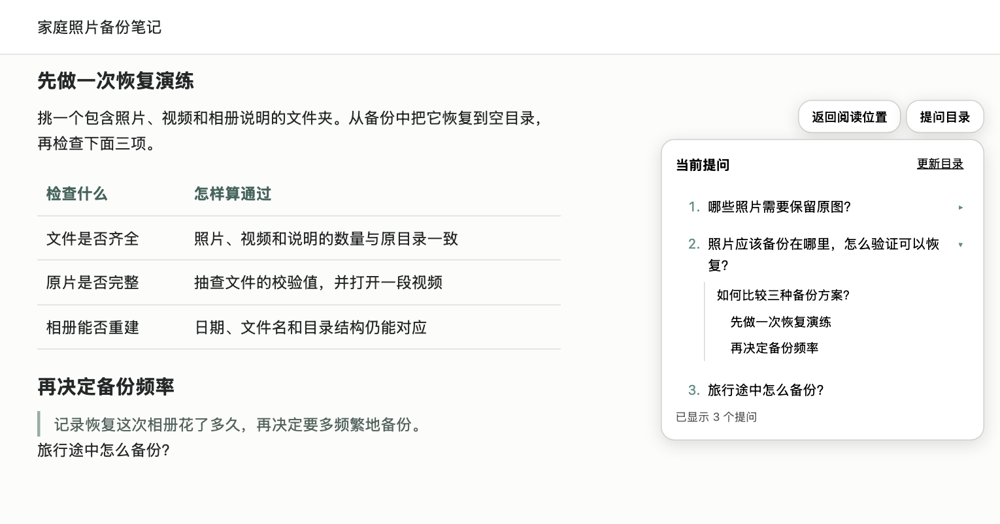

# ChatGPT Reading Panel · ChatGPT 长对话阅读面板

在 ChatGPT 网页旁生成可点击的提问目录。点问题回到原文，展开 ▸ 就能看到这条回答的 Markdown 一级、二级标题。读完某一节，点「返回阅读位置」继续刚才的段落。

**ChatGPT Reading Panel** is a Chrome extension that adds a table of contents to long ChatGPT conversations. Jump to a user prompt or an H1/H2 heading in its answer, then return to your previous reading position. The outline is cached locally in Chrome.

*图中是运行 1.4.0 扩展脚本的演示页面。公开示例使用虚构对话。*

## 三种读法

| 你正在做什么 | 在面板里怎么读 |
| --- | --- |
| **整理家庭照片**，想从很长的备份建议里找回恢复步骤 | 展开「照片应该备份在哪里，怎么验证可以恢复？」→ 点「先做一次恢复演练」。如上图，右边保留目录，左边直接看到操作清单。 |
| **排查程序报错**，前后两次回答里都有「验证方法」 | 展开第二次回答所属的问题，再点它下面的「验证方法」。核对完命令，点「返回阅读位置」接着看日志。 |
| **做文献笔记**，隔天回来又追问了两篇论文 | 重开聊天先看本机保存的目录。点「更新目录」核对末尾新增的提问和回答标题，旧条目继续保留。 |

## 安装与更新

1. 从 GitHub 的 **Code → Download ZIP** 下载并解压，或用 `git clone https://github.com/RexWHuang/ChatGPT-Reading-Panel.git` 克隆。把文件夹放在长期保留的位置。
2. 打开 Chrome 的 `chrome://extensions`，开启「开发者模式」，点「加载未打包的扩展程序」，选择直接包含 `manifest.json` 的文件夹。
3. 刷新已有的 ChatGPT 聊天页。使用旧版的人更新同一目录后，点扩展卡片上的圆形「重新加载」按钮，再刷新聊天页。1.3.0 新增本地存储权限。

## 目录何时出现

- 打开聊天，右侧会自动显示提问。再次访问时先显示本机保存的目录。点一条提问跳到原文，点「返回阅读位置」回到刚才的段落。
- 问题旁的 ▸ 可以展开这条回答的一级、二级标题，二级标题向内缩进。点标题会跳到对应段落，尽量让标题贴近可见区域顶部。点问题文字仍可回到提问原文。
- 首次访问也可以边读边用。页面已经显示的提问会先出现。如果网页正常加载的对话数据包含完整的当前分支，目录会自动补齐。展开或收起目录都不会启动扫描。
- 如果网页只提供一部分消息，目录会随阅读逐步补充。点「更新目录」会保留已有目录，从上次最后一个提问核对新提问和回答标题。如果末尾已在页面中，会就地更新；遇到虚拟滚动时，读取末尾后恢复阅读位置。
- 侧栏平时沿用页面原色。悬停在某个标题上会显示页面提供的时间，并轻微放大该行和相邻行；启用系统「减少动态效果」时关闭缩放。

侧栏示例同样使用虚构的聊天标题。

## 缓存和请求

目录按聊天 ID 存入 `chrome.storage.local`，包括提问文字、回答的一级和二级标题、可用的消息 ID 和定位用的滚动位置。请把本地目录视作聊天内容的一份副本。卸载扩展可清除该扩展的本地缓存。

扩展只在 chatgpt.com 页面运行。它读取网页已发起的对话请求的响应副本，从当前分支提取用户问题。扩展本身不发对话请求，不调用模型，也没有定时刷新。自动显示和恢复目录都不会滚动正文。点击跳转或手动更新时，ChatGPT 自身可能为滚动到的位置加载历史消息。

## 虚拟滚动与验证边界

ChatGPT 会移除屏幕外的消息。遇到页面没有提供完整文本分支的情况，面板会显示「已显示 N 个提问」，并保存已读到的部分。若上次末尾和最新消息之间隔着尚未显示的内容，会从已知末尾向后补读，最多十秒。无法接上时会提示目录仍有缺口，后续随阅读补入。切换对话、隐藏页面或手动滚动可中断补读。

- **真实 Chrome，1.4.0**：展开一条长对话中第一条提问的回答目录，先点一级标题，再点紧随其后的二级标题。两次跳转稳定后，标题上沿均距固定页头底边 7.79 个 CSS 像素。
- **隔离 Chromium，1.4.0**：模拟长对话从已保存的 10 个提问增至 16 个，更新后顺序完整，恢复到原阅读位置。停在末尾再次更新，滚动和缓存写入均为零。另测同名二级标题，点击第二个后定位到对应段落，标题停在固定页眉下方约 8 像素。两项测试均未产生额外对话请求。
- **隔离 Chromium，1.3.1**：在只有末尾三个提问出现在页面的样例中，进入后直接显示这三条。网页自己的对话请求返回后，目录补齐当前分支的 16 条提问。测试记录到一次网页请求、零次自动滚动。重访时，在正文出现前已从缓存显示 16 条，展开与收起没有增加请求。测试使用模拟对话响应和扩展存储。
- **真实 Chrome，1.2 系列**：一条长对话读出 16 个提问，抽测第 1、8、16 条跳转。一次返回测试回到了同一段落，位置偏差 0 像素。此结果覆盖当时的页面结构。
- **隔离 Chromium，1.3.0**：用三个演示提问验证首次自动建目录、保存一次、刷新后缓存命中、跳转和返回。测试使用模拟的扩展存储接口。缓存命中后打开目录，滚动调用和写入次数均为零。
- 网页结构、缩放、图片延迟加载及其他修改页面的扩展都可能影响定位。页面未提供创建或更新时间时，无法补全。

## English quick start

1. Clone or download this repository. In Chrome, open `chrome://extensions`, enable **Developer mode**, choose **Load unpacked**, and select the folder containing `manifest.json`.
2. Refresh an existing chat on **chatgpt.com**. Click a question in the outline to jump to that prompt. Expand the arrow next to it to navigate the Markdown headings in its answer.
3. Click **返回阅读位置** to go back to where you were reading. **更新目录** checks the latest turns against the saved outline. ChatGPT itself may load older messages when you navigate to them.

## 许可证

[MIT](LICENSE)。本项目独立开发，与 OpenAI 无隶属关系。
